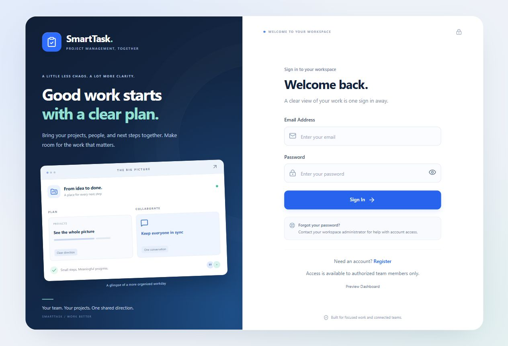

# SmartTask

### Smart Task & Project Management System

**Bright Mind Ltd. - Full-Stack Developer Recruitment Assignment**  
**Author:** [Mahedee Hasan Shishir](https://github.com/mhshishir009)

A full-stack workspace for organizing projects, assigning work, following task progress, and keeping project conversations in one place. SmartTask combines a responsive React interface, an Express REST API, and PostgreSQL persistence with role-based authorization, versioned task updates, project discussions, and event notifications.

[Setup](#local-setup) · [API reference](docs/API.md) · [Postman collection](docs/SmartTask.postman_collection.json) · [Database](docs/DATABASE.md) · [Verification](docs/VERIFICATION.md) · [AI Usage Report](AI-USAGE-REPORT.md)

> **Release status:** locally implemented and verified. The GitHub repository and public deployment have not been created yet. No working public demo URL or shared demo password is claimed here. Hosting preparation is documented in [Deployment](docs/DEPLOYMENT.md).

## What you can do

### Accounts and permissions

- Register as a Team Member and sign in with JWT authentication.
- Use separate Admin and Team Member views with protected frontend routes and backend authorization.
- Create users as an Admin, issue an initial temporary password, edit names/emails, and deactivate eligible accounts.
- Require seeded/admin-created accounts to change their initial password before accessing the workspace.
- Change passwords with current-password verification; successful changes invalidate older tokens.
- Sign out by clearing the browser session. Forgotten-password guidance directs users to their administrator; there is no automated email reset flow.

### Projects and tasks

- Create, list, edit, archive, and delete eligible projects as an Admin.
- Browse organized project cards with search, archive filters, sorting, and task progress.
- Create tasks with an active assignee, project, priority, optional description, and deadline.
- Follow **To Do → In Progress → Completed**; reverse transitions and reopening are not implemented.
- Edit/reassign/delete tasks as an Admin. Members can view their own assigned tasks and advance their status.
- Filter the Admin task API by project, status, priority, and assignee using combined criteria; search tasks in the frontend.
- Prevent stale updates/deletions with `expectedVersion` and transactional checks.
- Preserve archived projects and discussion history through explicit business rules.

### Analytics and workspace navigation

- Show total projects, total/assigned tasks, completed, pending, in-progress, and overdue work.
- Visualize task status with a donut chart and task priority with a categorical bar chart.
- Review project completion and active-user metrics in the Admin dashboard.
- Find projects, authorized tasks, and Admin-visible users from the header search.
- Use responsive Login, Register, and Change Password pages with a shared visual theme.

Dashboard values are calculated in the frontend from protected project/task/user APIs. There is **no separate `/api/dashboard` endpoint**. Members see task metrics for their assignments; project names and descriptions remain visible to both roles.

### Project Discussion

- Send plain-text messages scoped to a project, with sender and timestamp.
- Allow Admins to access all project discussions; require a current project task assignment for Members.
- Keep archived discussions readable while blocking new messages.
- Load the latest 50 messages, retrieve older pages, and refresh manually.
- Revoke discussion access when a Member no longer has any task assigned in the project.

### Event notifications

| Event | Recipients |
|---|---|
| Project created | Active Admins |
| Task created and assigned | Active Admins and assigned Member |
| Task reassigned | Active Admins, previous and new active assignees |
| Task status changed | Active Admins and active assignee |
| Project archived | Active Admins and active Members currently assigned tasks in that project |
| Discussion message sent | Active Admins and active Members currently assigned tasks in that project |

The bell shows unread counts, timestamps, a recipient-specific history, earlier pages, and **Mark all as read**. Clicking a notification marks it read and opens its target when current permissions permit. The sender's own action is read history, not an unread alert. Task creation and initial assignment generate one event. Notifications are stored in the same transaction as the successful action, and duplicate event delivery is prevented per recipient.

Notifications refresh every 30 seconds while the browser document is visible, on window focus, and on explicit refresh/open. Discussion messages use manual refresh. There are no WebSockets, email/push notifications, scheduled overdue alerts, or backfilled notifications for older actions.

## Preview



[Register](docs/images/register.png) · [Change Password](docs/images/change-password.png) · [Project Discussion](docs/images/discussion.png) · [Notification bell](docs/images/notifications.png)

Authentication screenshots show the current presentation with empty fields. Discussion/notification images use synthetic verification data; they are illustrations of the interface, not production activity.

## Technology stack

| Layer | Actual implementation |
|---|---|
| Frontend | React 19, TypeScript, Vite 8, React Router 7 |
| UI | Tailwind CSS 4, scoped authentication CSS, Lucide React, code-based charts |
| HTTP client | Axios with Bearer token injection |
| Backend | Node.js, Express 5, TypeScript compiled to CommonJS |
| Architecture | Domain, application services/DTOs, infrastructure repositories, presentation routes/controllers |
| Persistence | PostgreSQL, TypeORM, `pg`, explicit migrations; `synchronize: false` |
| Authentication | HS256 JWT, Argon2id password hashing, database-backed account/session checks |
| Verification | Vitest unit/HTTP integration tests, frontend ESLint/build, PostgreSQL temporary-table smoke checks |

The lockfiles pin installed versions. This project does not use bcrypt, express-validator, Google OAuth, or an external chart library.

## Project structure

```text
SmartTaskProjectManagementSystem/
├── src/
│   ├── domain/                # Entities and repository contracts
│   ├── application/           # Services, DTOs, security interfaces
│   ├── infrastructure/
│   │   ├── database/          # TypeORM configuration, entities, migrations, seeds
│   │   ├── repositories/      # Persistence, locking, notification event writes
│   │   └── security/          # Argon2id and JWT implementations
│   ├── presentation/          # Routes, controllers, middleware, view models
│   ├── config/container.ts    # Dependency wiring
│   ├── app.ts                # Express application and error handling
│   └── server.ts             # Database connection and server startup
├── frontend/
│   ├── src/
│   │   ├── components/        # Auth shell, cards, charts, discussion, header controls
│   │   ├── context/           # Auth provider/context
│   │   ├── pages/             # Auth, dashboard, projects, tasks, users, roles
│   │   └── services/          # API client and presentation helpers
│   ├── .env.example
│   └── package.json
├── tests/
│   ├── unit/                  # Services, repositories, frontend helpers/rendering
│   ├── integration/           # Real HTTP routes with isolated repository fixtures
│   ├── database/              # Real PostgreSQL checks using temporary tables
│   └── browser/               # Synthetic discussion/notification preview harnesses
├── docs/                      # API, database, verification, deployment, submission
├── .env.example
├── AI-USAGE-REPORT.md
├── package.json               # Backend scripts; run from the repository root
└── README.md
```

## Local setup

### 1. Prerequisites

- Node.js **24.x** and npm (verified locally with Node 24.19.0 and npm 11.17.0).
- A running PostgreSQL instance and a database user permitted to create application tables.
- Git for eventual GitHub publishing.

Vite declares Node `^20.19.0 || >=22.12.0`; use the verified Node 24 environment for this submission. Other Node/PostgreSQL versions have not been independently certified here.

Open a terminal in the project root: the directory containing `src/`, `frontend/`, and the root `package.json`.

### 2. Install locked dependencies

```bash
npm ci
npm --prefix frontend ci
```

Keep both lockfiles. The root is the backend; there is no `server/` directory.

### 3. Configure local environment files

PowerShell, from the root:

```powershell
Copy-Item .env.example .env
Copy-Item frontend/.env.example frontend/.env
```

macOS/Linux equivalents:

```bash
cp .env.example .env
cp frontend/.env.example frontend/.env
```

Do this only on first setup; do not overwrite existing working `.env` files. Edit root `.env`:

| Variable | Purpose |
|---|---|
| `PORT` | API port, normally `5000` |
| `DB_HOST`, `DB_PORT` | PostgreSQL host and port |
| `DB_USER`, `DB_PASSWORD`, `DB_NAME` | Database connection credentials/name |
| `JWT_SECRET` | Unique random secret, **at least 64 characters** |
| `JWT_EXPIRES_IN` | JWT lifetime, defaults to `1h` |
| `ADMIN_EMAIL`, `ADMIN_PASSWORD` | Initial Admin seed credentials; password at least 12 characters |

Generate your own secret locally:

```bash
node -e "console.log(require('node:crypto').randomBytes(48).toString('hex'))"
```

For local development, leave `frontend/.env` as `VITE_API_BASE_URL=/api`. Vite forwards `/api` to `http://localhost:5000`. If you change the API port, the current dev proxy also needs to match it. Root/backend secrets never belong in `VITE_*` variables or committed files.

### 4. Create the database, migrate, and seed

```bash
npm run db:create
npm run migration:run
npm run seed:roles
npm run seed:admin
npm run db:check
```

`db:create` connects to PostgreSQL's `postgres` database and needs database-creation privileges. If your account lacks them, create the configured database in pgAdmin/psql and skip that command. Use a lowercase database name such as `smarttask_dev`.

There are **six migrations**: roles, users, projects, tasks, project messages, and notifications. Role seeding runs before Admin seeding. The Admin seed does not reset an existing account and never prints its password. Inspect applied migrations with:

```bash
npm run migration:show
```

[Database details and seed behavior](docs/DATABASE.md) · [Disposable demonstration data walkthrough](docs/SAMPLE-DATA.md)

### 5. Run both applications

Terminal 1, project root:

```bash
npm start
```

Terminal 2, project root:

```bash
npm --prefix frontend run dev
```

Alternatively, inside `frontend/`, run `npm run dev` without `--prefix frontend`.

- Frontend: normally `http://localhost:5173` (use the URL Vite prints).
- API health: `http://localhost:5000/api/health`.
- REST base: `http://localhost:5000/api`.

`npm start` builds the backend through its prestart hook before starting `dist/server.js`. Restart it after backend changes. Server startup initializes PostgreSQL before serving requests. The health route itself returns an API-running message; `npm run db:check` is the explicit database connection check.

### 6. First sign-in

1. Sign in with the Admin email/password you configured for the seed.
2. Change the initial password when prompted, then sign in again with the new one.
3. Register a Member or create one from Users using an Admin-issued temporary password.
4. Create a project and assign a task to an active account.
5. Sign in as that Member to review assigned tasks, update status, and use the project discussion.

No real personal accounts or reusable public Admin credentials are included.

## Business rules and access

| Capability | Admin | Team Member |
|---|---|---|
| Read project names/descriptions | All projects | All projects |
| Create/edit/archive/delete eligible projects | Yes | No |
| List all tasks, create/edit/reassign/delete eligible tasks | Yes | No |
| Read project tasks / task by ID | All tasks | Own assigned tasks only |
| Advance task status | Any eligible task | Own assigned tasks only |
| User management | Yes, with system/last-admin protection | No |
| Project discussion | All projects | Projects with a current task assignment |
| Notification history/read actions | Own recipient records | Own recipient records |

- New tasks and reassignment require an active assignee. Existing legacy unassigned records can be assigned by an Admin.
- Task mutations require the latest numeric `expectedVersion`; successful task updates increment the version.
- Deadlines use ISO 8601 timestamps with an explicit timezone. Invalid calendar dates are rejected; deadlines are optional, and past deadlines can represent overdue work.
- Archived project details/tasks cannot be modified. Archiving requires every project task to be `DONE`; an empty project can also be archived.
- Projects containing any task or discussion message cannot be deleted. Eligible task deletion does not cascade into project deletion.
- Notifications do not grant resource access. Reassigned/deleted targets may remain as read-only history without a navigable destination.

## API documentation

Use [the full API reference](docs/API.md) for the 31 method/path combinations, payloads, status codes, versioning, filters, and cursor behavior. Import [the Postman collection](docs/SmartTask.postman_collection.json) for individual manual requests. It contains no saved access token or real credential; set its local variables before use.

Examples of protected requests use:

```http
Authorization: Bearer YOUR_ACCESS_TOKEN
Content-Type: application/json
```

There is no server logout endpoint. Frontend logout clears session storage; already issued tokens expire normally or become invalid after an account/password state change. This distinction is deliberate documentation of the current behavior.

## Verification

From the root:

```bash
npm test
npm run typecheck
npm run build
npm --prefix frontend run lint
npm --prefix frontend run build
```

Latest verification on **26 October 2026**: **294 tests passed across 22 files**, backend typecheck/build passed, frontend lint/build passed. These are locally executed results, not a hosted CI badge. Database smoke commands and manual coverage are detailed in [Verification](docs/VERIFICATION.md).

```bash
# Requires a reachable PostgreSQL database and a current backend build.
node tests/database/discussionSmoke.cjs
node tests/database/notificationSmoke.cjs
```

These scripts isolate fixtures in PostgreSQL temporary tables and roll them back. HTTP integration tests use isolated fixtures; the test count should not be interpreted as 294 live-browser end-to-end tests.

## Deployment and submission

- [Deployment readiness](docs/DEPLOYMENT.md): frontend build settings, API/database requirements, proxy/CORS/TLS gaps, and live checks.
- [GitHub and submission checklist](docs/SUBMISSION.md): repository preparation, ignored files, commit history, and deliverables.
- [AI Usage Report](AI-USAGE-REPORT.md): tools, three prompts, a solved issue, an incomplete suggestion, and verification.

This documentation update does not deploy the application or add deployment-specific code. The current Vite proxy works in development only; publishing just the frontend is insufficient for a working online system.

## Current boundaries

- No SMTP password reset, Google/social login, refresh-token endpoint, or server-side per-token logout revocation.
- No dedicated dashboard endpoint; no Kanban drag/drop, subtasks, dependency management, calendar, or file attachments.
- Notifications are event-based polling, not WebSocket delivery or automatic overdue reminders. Discussions use manual refresh and have no edit/delete endpoints.
- No Docker setup or GitHub Actions workflow is claimed. Hosted deployment and a fresh GitHub clone verification remain pending.
- Package metadata currently declares `ISC`; no standalone license grant has been added. Choose and review a license before presenting the project as MIT-licensed or similar.

Built by **Mahedee Hasan Shishir** for the Bright Mind Ltd. recruitment assignment. AI assistance and candidate review are disclosed in the accompanying report.
