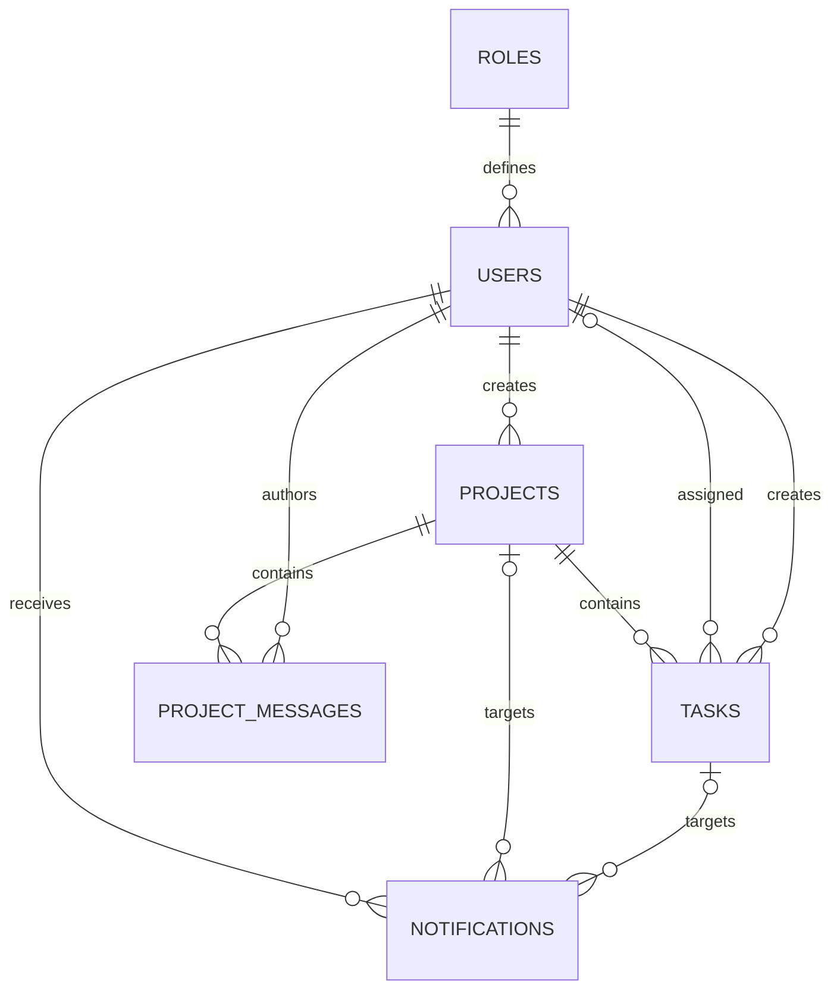

# Database, migrations and seeds

PostgreSQL is accessed through TypeORM and parameterized SQL. The application data source is `src/infrastructure/database/data-source.ts`; schema synchronization is disabled. The migrations, not an additional hand-maintained schema.sql, are the authoritative schema definition.

## Tables and relationships

| Table | Main fields and constraints |
|---|---|
| `roles` | Smallint ID, unique `ADMIN`/`TEAM_MEMBER` code, nonblank role name |
| `users` | Role FK, name, unique case-insensitive email index, Argon2id hash, active/system-Admin/password-change flags, nonnegative auth version, timestamps |
| `projects` | Creator FK, nonblank name up to 200 characters, description, archive flag, timestamps |
| `tasks` | Project/creator/assignee FKs, title, description, checked status/priority enums, optional deadline, version >=1, timestamps |
| `project_messages` | Project/author FKs, body constraint, created timestamp, project/message index |
| `notifications` | Recipient FK, event key/type/text, optional project/task targets, read/created timestamps; unique recipient/event key and unread/latest indexes |



The database permits legacy nullable task assignees, while current create/reassign APIs require an active assignee. API IDs are safe JavaScript numbers; PostgreSQL identities are bigint.

## Migration order

| Timestamp | Class purpose |
|---|---|
| `1792666695602` | CreateRolesTable |
| `1792672059728` | CreateUsersTable |
| `1792731267331` | CreateProjectsTable |
| `1792763102764` | CreateTasksTable |
| `1792999492767` | CreateProjectMessages |
| `1793082000000` | CreateNotifications |

Run from the root:

```bash
npm run db:create
npm run migration:run
npm run seed:roles
npm run seed:admin
npm run migration:show
```

The commands build TypeScript first and operate on the database configured in root `.env`. Migrations are recorded in TypeORM's `migrations` table. `db:create` is optional if the configured database already exists; it does not drop an existing database. Do not use schema resets or `synchronize:true` to prepare a submission.

## Seeds and demonstration records

- `seed:roles` inserts the two default roles and ignores existing conflicts. On a fresh database their IDs are 1/2, which match the authorization convention.
- `seed:admin` reads `ADMIN_EMAIL` and `ADMIN_PASSWORD`, hashes the password, creates **System Administrator**, and requires first-login password change. An existing email is left unchanged; rerunning the seed is not a password-reset mechanism.
- Admin password must be at least 12 characters. JWT secret must be unique and at least 64 characters.
- Existing local test records are not exported. Create disposable demonstration data through the [API/UI walkthrough](SAMPLE-DATA.md); no public dump of personal users/emails/passwords is provided.

## Consistency and retention

- Task create/update/delete and project archive/delete use parent-before-task locking. Task version checks occur within the relevant transaction.
- A project with tasks or discussion messages cannot be deleted; message history is protected by restrictive foreign keys.
- Notifications are written inside the transaction that created the action. Their optional project/task FKs become null when eligible targets are deleted, preserving history without preventing the original deletion flow.
- Recipient/event uniqueness prevents duplicate delivery of the same event to the same user. Deleting a recipient at the database level cascades its notification rows; the user UI normally deactivates rather than deletes accounts.
- Discussion send rechecks active identity, assignment and archive state under transaction locks.
- Password changes update account authentication state so previously issued tokens fail middleware checks.

The PostgreSQL smoke scripts verify migrations and production repositories in temporary tables, then roll back. They are not data backup/export tools. Hosting-specific encrypted database connectivity and backup policies still need to be configured before public deployment.
